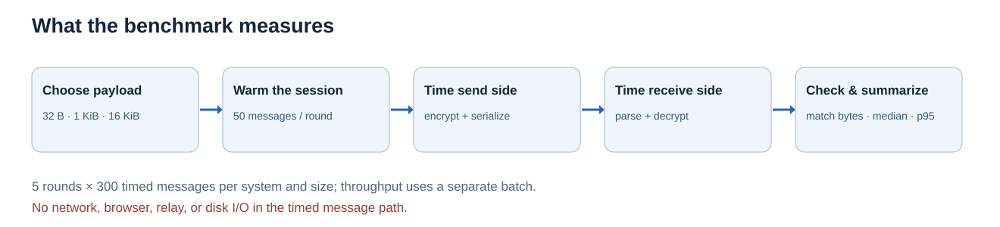
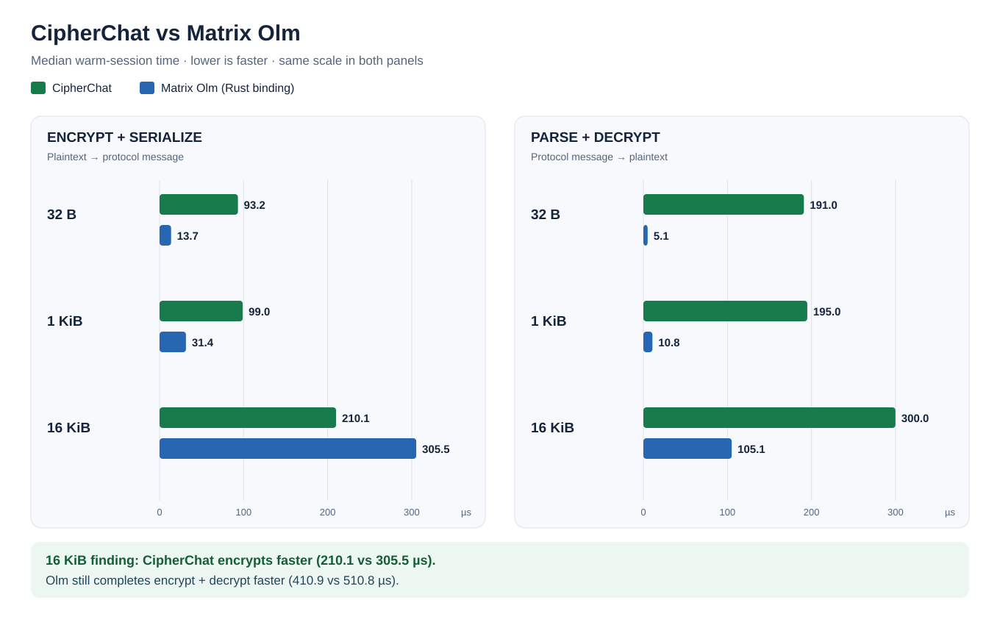
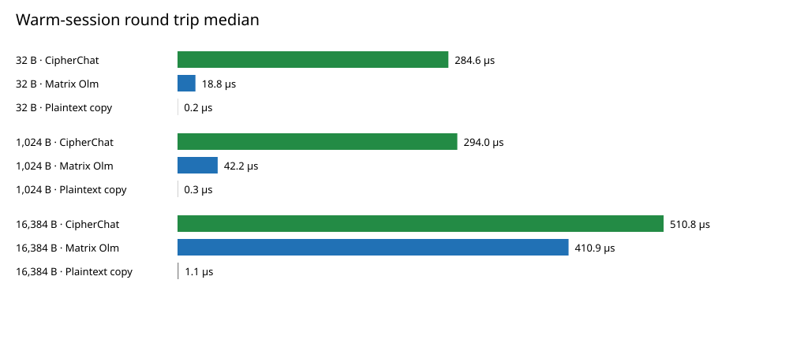
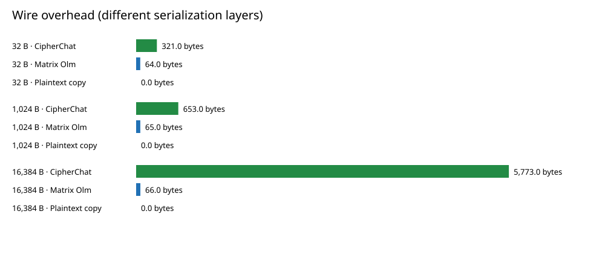

# CipherChat benchmark: simple complete report

**Run date:** 2026-11-03T05:33:16.840995+00:00  
**Machine:** Apple M3; macOS-27.0-arm64-arm-64bit-Mach-O  
**Software:** Python 3.14.6, cryptography 46.0.7, vodozemac 0.10.0  
**Code revision:** `bf54e2e`

## 1. What did we want to learn?

We wanted to know how long CipherChat takes to protect and recover a message, how many bytes its message format adds, and how those measurements compare with an established encrypted-messaging implementation. We used Matrix Olm's Rust `vodozemac` implementation through Python bindings. A plain byte copy was measured as an **insecure control** to show a rough lower bound.

## 2. What did we actually measure?



The input was an ASCII message of **32 B, 1 KiB (1,024 B), or 16 KiB (16,384 B)**. Each system and size received **50 untimed warm-up messages**, followed by **300 timed messages** in each of **5 rounds**. This gave **1,500 individual timing samples** for every system and size. The run rotated which system went first and checked that every decrypted message matched its input. A separate batch measured throughput. Fresh-session setup was measured 100 times per encrypted system; CipherChat rekey was measured 100 times.

The timer starts before encryption and message serialization. A second timestamp separates the send and receive sides. It stops after parsing and decryption. **No browser, port 8000 server, socket, relay, LAN transfer, or disk write is in the timed message path.**

## 3. Terms used in the results

| Term | Simple meaning |
| --- | --- |
| Payload | Original message size before protection. |
| Encrypt median | Typical time to encrypt **and serialize** one message; lower is faster. |
| Decrypt median | Typical time to parse **and decrypt** one message; lower is faster. |
| Round-trip median | Typical combined send-and-receive processing time in this one process. It does **not** mean internet round trip. |
| p95 | 95% of measured operations completed within this time; the slowest 5% took longer. It is not the maximum. |
| Throughput | Complete message operations per second in a separately timed batch; higher is faster. |
| Wire bytes | Size of the representation counted by this harness. |
| Overhead bytes | Wire bytes minus original payload bytes. |
| µs | Microsecond: one millionth of a second. 1,000 µs = 1 millisecond. |

Each median is computed independently. The displayed encrypt and decrypt medians therefore may differ slightly from the displayed combined median when added.

## 4. Complete warm-session results

| Payload | System | Encrypt (µs) | Decrypt (µs) | Combined median (µs) | Combined p95 (µs) | Throughput (msg/s) | Wire bytes | Overhead bytes |
| ---: | --- | ---: | ---: | ---: | ---: | ---: | ---: | ---: |
| 32 | CipherChat | 93.2 | 191.0 | 284.6 | 321.7 | 3,504.4 | 353 | +321 |
| 32 | Matrix Olm | 13.7 | 5.1 | 18.8 | 21.0 | 51,998.3 | 96 | +64 |
| 32 | Plaintext copy | 0.1 | 0.1 | 0.2 | 0.3 | 2,336,903.6 | 32 | +0 |
| 1,024 | CipherChat | 99.0 | 195.0 | 294.0 | 317.8 | 3,365.4 | 1,677 | +653 |
| 1,024 | Matrix Olm | 31.4 | 10.8 | 42.2 | 42.6 | 23,388.8 | 1,089 | +65 |
| 1,024 | Plaintext copy | 0.2 | 0.2 | 0.3 | 0.4 | 2,022,476.5 | 1,024 | +0 |
| 16,384 | CipherChat | 210.1 | 300.0 | 510.8 | 568.5 | 1,914.8 | 22,157 | +5,773 |
| 16,384 | Matrix Olm | 305.5 | 105.1 | 410.9 | 481.1 | 2,386.0 | 16,450 | +66 |
| 16,384 | Plaintext copy | 0.6 | 0.5 | 1.1 | 1.4 | 672,959.6 | 16,384 | +0 |

## 5. Read the comparison graph



**Green** means CipherChat and **blue** means Matrix Olm. Both panels use the same horizontal microsecond scale. A shorter bar means less measured time. The left panel is encryption plus serialization; the right is parsing plus decryption.

- **32 B:** Fixed per-message work is large compared with the tiny payload. CipherChat takes 284.6 µs combined, while Olm takes 18.8 µs.
- **1 KiB:** CipherChat takes 294.0 µs combined versus Olm 42.2 µs: about 7.0 times the measured time. Their p95 values are 317.8 and 42.6 µs.
- **16 KiB:** CipherChat is faster **only for encrypting and serializing**: 210.1 versus Olm 305.5 µs. CipherChat is slower at parsing and decrypting: 300.0 versus 105.1 µs. Consequently Olm wins the **complete** operation: 410.9 versus CipherChat 510.8 µs.

The plaintext-copy control is much faster because it does not encrypt, authenticate, sign, or check replay. It is not a secure chat option.

### Other views of the same saved data



This chart combines the send and receive sides; shorter bars mean a faster complete local operation.



This chart shows the number of bytes beyond the plaintext size. It compares the harness's selected representations, not complete network packets.

## 6. Why might this have happened?

CipherChat builds message metadata, signs each encrypted message, Base64-encodes binary values, and writes a full JSON envelope. On receipt it parses JSON, decodes Base64, validates the envelope, verifies the Ed25519 signature, and decrypts. These steps are **plausible** contributors to the higher small-message and receive-side times. Olm's core is implemented in Rust, whereas CipherChat's protocol and JSON work run in Python with native cryptographic primitives.

CipherChat’s 16 KiB JSON envelope is 22,157 bytes; Olm’s measured binary message body is 16,450 bytes. Base64 makes binary ciphertext larger when put into JSON. The harness counts **different serialization layers**: it does not include the full Matrix event JSON, so these figures cannot establish complete network-packet superiority.

The benchmark did not time JSON, signatures, AES, ratcheting, or language overhead separately. It therefore **cannot prove a single cause** for the timing gap or the 16 KiB send-side result.

## 7. Setup and rekey results

| Operation | Median (µs) | p95 (µs) |
| --- | ---: | ---: |
| CipherChat fresh conversation | 686.4 | 1,162.2 |
| Matrix Olm fresh conversation | 329.6 | 822.7 |
| CipherChat signed two-party rekey | 1,081.3 | 1,743.1 |

CipherChat setup creates two identities and pinned sessions. Olm setup creates accounts, a pre-key message, and an acknowledgement. Those are different procedures; their times are not directly equivalent. CipherChat rekey timing excludes transport delay and the follow-up test message.

## 8. What does this mean for the project?

The result suggests profiling CipherChat’s receive path, JSON parsing, Base64 conversions, and per-message signing and verification. A compact encoding might reduce bytes, but its benefit must be measured after implementation. For a stronger comparison, measure both complete network formats and separately time the full port 8000 user experience. These measurements describe one host and this specific run, not a universal speed ranking or a security ranking.

## 9. Reproduce and inspect the evidence

```bash
python3 -m venv benchmarks/.venv
benchmarks/.venv/bin/python -m pip install -r benchmarks/requirements.txt
benchmarks/.venv/bin/python benchmarks/run.py
```

The generated files are [summary.csv](summary.csv) (table), [results.json](results.json) (raw timings), [encryption_decryption_comparison.svg](encryption_decryption_comparison.svg) (main chart), [benchmark_method.svg](benchmark_method.svg) (method diagram), [roundtrip_latency.svg](roundtrip_latency.svg), and [wire_overhead.svg](wire_overhead.svg). The [presentation guide](PRESENTATION_GUIDE.md) gives a slide-by-slide script.

The comparator sources are [vodozemac Python bindings](https://github.com/matrix-nio/vodozemac-python) and [Matrix vodozemac](https://github.com/matrix-org/vodozemac).
