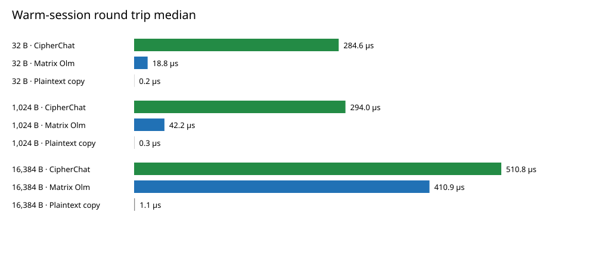
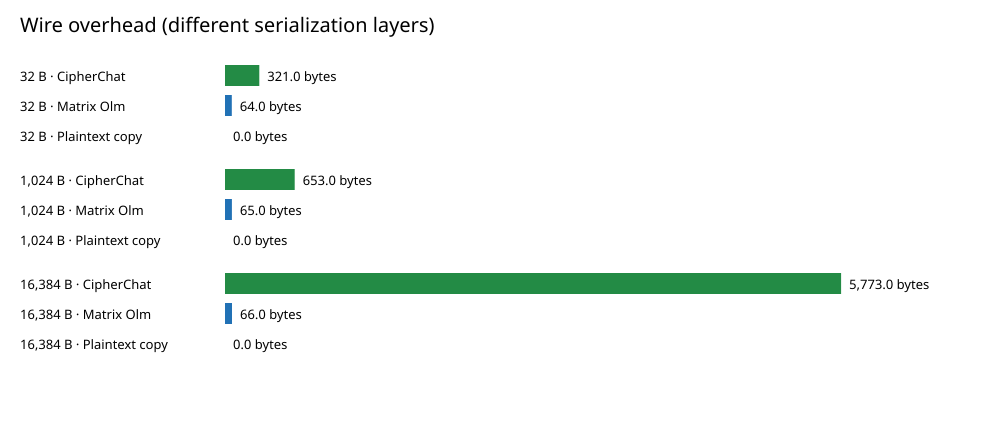

# CipherChat performance benchmark

Run: 2026-11-03T05:33:16.840995+00:00 · commit `bf54e2e`

## Method

Local, single-process benchmark of a warm one-to-one messaging session. Payloads: 32 B, 1 KiB, 16 KiB. 5 rounds × 300 timed messages per system and size, after 50 warm-up messages each round. The order rotates by round. Each message is checked for correct decryption. Median and p95 use individual `perf_counter_ns` timings; throughput uses a separate whole-batch pass. No network, relay, disk, browser, or UI time is included.

The Matrix comparator is the Rust `vodozemac` Olm implementation called through Python bindings; the original C/C++ Olm library was not measured. Both paths run in the same Python interpreter. CipherChat's protocol and JSON work run in Python, using native cryptographic primitives through `cryptography`. The plaintext copy is an insecure lower-bound control, not a messaging alternative.

## Environment

- CPU: Apple M3
- OS: macOS-27.0-arm64-arm-64bit-Mach-O
- Python: 3.14.6
- cryptography: 46.0.7
- vodozemac: 0.10.0

## Warm-session results

| Payload | System | Encrypt median (µs) | Decrypt median (µs) | Round trip median / p95 (µs) | Throughput (msg/s) | Wire bytes / overhead |
| ---: | --- | ---: | ---: | ---: | ---: | ---: |
| 32 B | CipherChat | 93.2 | 191.0 | 284.6 / 321.7 | 3,504.4 | 353 / +321 |
| 32 B | Matrix Olm | 13.7 | 5.1 | 18.8 / 21.0 | 51,998.3 | 96 / +64 |
| 32 B | Plaintext copy | 0.1 | 0.1 | 0.2 / 0.3 | 2,336,903.6 | 32 / +0 |
| 1,024 B | CipherChat | 99.0 | 195.0 | 294.0 / 317.8 | 3,365.4 | 1,677 / +653 |
| 1,024 B | Matrix Olm | 31.4 | 10.8 | 42.2 / 42.6 | 23,388.8 | 1,089 / +65 |
| 1,024 B | Plaintext copy | 0.2 | 0.2 | 0.3 / 0.4 | 2,022,476.5 | 1,024 / +0 |
| 16,384 B | CipherChat | 210.1 | 300.0 | 510.8 / 568.5 | 1,914.8 | 22,157 / +5,773 |
| 16,384 B | Matrix Olm | 305.5 | 105.1 | 410.9 / 481.1 | 2,386.0 | 16,450 / +66 |
| 16,384 B | Plaintext copy | 0.6 | 0.5 | 1.1 / 1.4 | 672,959.6 | 16,384 / +0 |

## Findings

- At 1 KiB, CipherChat measured 294.0 µs versus 42.2 µs for Olm (7.0× the time on this host).
- CipherChat produced 1,677 JSON-envelope bytes; Olm produced 1,089 binary-message bytes. These are different serialization layers.
- Protocol, serialization, signature, and language costs are combined; this test does not attribute the gap to one component.

## Session operations

| Operation | Median (µs) | p95 (µs) |
| --- | ---: | ---: |
| CipherChat new conversation setup | 686.4 | 1,162.2 |
| Matrix Olm new conversation setup | 329.6 | 822.7 |
| CipherChat signed two-party rekey | 1,081.3 | 1,743.1 |

Setup includes different steps for each protocol and is not directly equivalent. Rekey excludes network delivery; a verified post-rekey message is excluded from timing.

## Charts





## Limitations

- This is one host and one Python process; measure real LAN and UI latency separately.
- Olm uses a ratchet; CipherChat uses a fixed session key until explicit rekey and signs each message. These are different feature sets.
- Olm wire bytes are the binary protocol body and exclude Matrix event JSON and transport metadata. CipherChat bytes are its full JSON envelope. No complete product-size ranking follows from this comparison.
- The language difference is only one possible factor. Component profiling is needed to explain timing costs.
- Raw timing samples contain no plaintext or key material: `results.json`; summary: `summary.csv`.

## Reproduce

```bash
python3 -m venv benchmarks/.venv
benchmarks/.venv/bin/python -m pip install -r benchmarks/requirements.txt
benchmarks/.venv/bin/python benchmarks/run.py
```

Sources: [vodozemac Python bindings](https://github.com/matrix-nio/vodozemac-python), [Matrix vodozemac](https://github.com/matrix-org/vodozemac).
